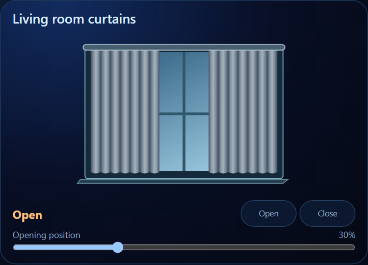
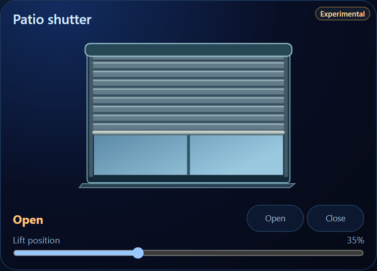
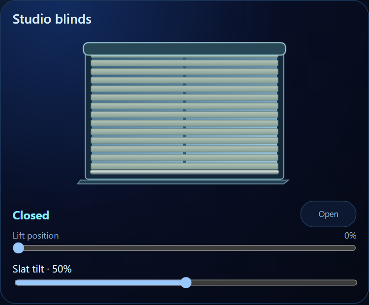
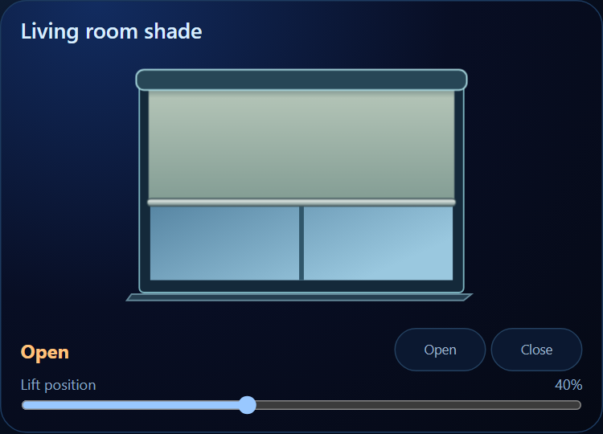
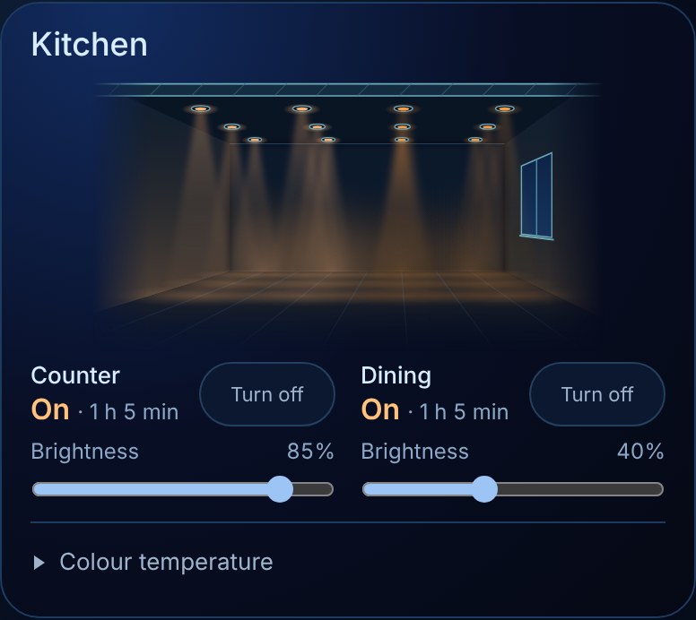

# Gleam Cards

**A collection of interactive cards for Home Assistant.** Start with the view you want, then make it yours in the visual editor. All four cards run locally and install as one bundle.

[**Try the live demo →**](https://magnusoverli.github.io/gleam-card/) · [Install in Home Assistant](#install)

## Gleam Energy Graph

**Stable** · See when your home used the most energy and what electricity cost that hour. Rotate the timeline to explore, or switch to Front view to compare.

<a href="https://magnusoverli.github.io/gleam-card/energy-graph/"></a>

[**Try Gleam Energy Graph →**](https://magnusoverli.github.io/gleam-card/energy-graph/) · [Graph settings](docs/energy-graph.md)

## Gleam Thermostat

**Experimental** · Turn the dial to set a target temperature. Fan, preset, and swing controls follow the capabilities of your climate device.

<a href="https://magnusoverli.github.io/gleam-card/thermostat/"></a>

[**Try Gleam Thermostat →**](https://magnusoverli.github.io/gleam-card/thermostat/) · [Thermostat settings](docs/thermostat.md)

## Gleam Cover

**Stable** · See which garage door is still open, raise a roller shade over a photo of your own view, or tilt the slats of a lowered blind.

**New in v0.0.11:** Draw a center-opening curtain or gather a single panel on either side. Choose the color and mounting side for any window cover, and stop a moving cover when its device supports Stop.

<a href="https://magnusoverli.github.io/gleam-card/cover/"></a>

| Roller shutter | Slatted blind |
| --- | --- |
|  |  |
| **Roller shade** | **Garage door** |
|  |  |

[**Try Gleam Cover →**](https://magnusoverli.github.io/gleam-card/cover/) · [Cover settings](docs/cover.md)

## Gleam Light

**New in v0.0.12** · **Room with ceiling spots** is the first Gleam Light type. Arrange spots in a grid or along the walls, then switch, dim and tune up to three zones. Add windows, a TV and a couch to match your room.

<a href="https://magnusoverli.github.io/gleam-card/light/"></a>

[**Try Gleam Light →**](https://magnusoverli.github.io/gleam-card/light/) · [Light settings](docs/light.md)

## Install

[](https://my.home-assistant.io/redirect/marketplace_repository/?owner=magnusoverli&repository=gleam-card&category=plugin)

1. Open the link above. If Gleam Cards isn’t in your catalog, confirm **Add custom repository** when prompted, then install the Dashboard package.
2. Reload the dashboard. Choose **Edit dashboard → Add card → Gleam Energy Graph**.
3. Under **Main energy → Sensor**, select a cumulative meter that reports kWh and has hourly Recorder statistics. Save the card. Price and current-hour readings are optional.

Prefer YAML? Replace the example entity with your meter:

```yaml
type: custom:gleam-energy-graph
energy_entity: sensor.total_energy
```

For climate controls, choose **Gleam Thermostat (Experimental)** and select a `climate.*` entity. For garage doors or window coverings, choose **Gleam Cover**, select the cover type, and pick your `cover.*` entity. For a room with ceiling spots, choose **Gleam Light** and add a `light.*` entity for each zone.

<details>
<summary>Manual installation</summary>

Copy [`dist/gleam-card.js`](dist/gleam-card.js) to `<Home Assistant config>/www/gleam-card.js`. In **Settings → Dashboards → Resources**, register `/local/gleam-card.js?v=1` as a **JavaScript module** and reload the browser. Advanced Mode may be needed to see Resources. When updating manually, change the version in the existing URL. If switching to the Marketplace, remove the manual resource to avoid loading both copies.

</details>

## Requirements and support

[Changelog, including unreleased changes](CHANGELOG.md)

[Release notes](https://github.com/magnusoverli/gleam-card/releases/latest) · [](https://github.com/magnusoverli/gleam-card/releases)

The graph requires **WebGL 2**; the thermostat’s HTML controls also work without the 3D dial. Cover and Light draw in SVG and do not require WebGL. No card needs a CDN or a separate backend integration.

[Energy Graph guide](docs/energy-graph.md) · [Thermostat guide](docs/thermostat.md) · [Cover guide](docs/cover.md) · [Light guide](docs/light.md) · [Report an issue](https://github.com/magnusoverli/gleam-card/issues)

For local previews, builds, and tests, see [Development](docs/development.md). Release instructions are in [Publishing](docs/publishing.md).

Gleam Cards by Magnus Øverli · [Unlicense](LICENSE) · [Third-party notices](THIRD_PARTY_NOTICES.md)
