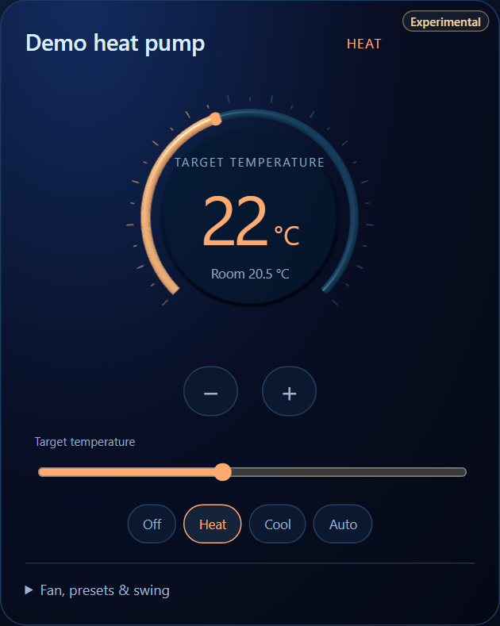

# Gleam Cards

[](https://github.com/magnusoverli/gleam-card/releases)

**Interactive cards for your Home Assistant dashboard.** Compare energy use with electricity prices, adjust the heat pump, or see which garage door is still open. Each card has a visual editor and runs locally.

[**Try the live demo ↗**](https://magnusoverli.github.io/gleam-card/) · [Install in Home Assistant](#install) · [Release notes](https://github.com/magnusoverli/gleam-card/releases/latest)


### Energy Graph · Stable

Start with a single cumulative meter. Add price, power, or voltage when you’re ready; if your price sensor publishes tomorrow’s rates, the graph shows those too.

[**Try Gleam Energy Graph**](https://magnusoverli.github.io/gleam-card/#energy-graph) · [Configure the graph →](docs/energy-graph.md)

### Thermostat · Experimental

Set a target temperature by turning the dial or using the keyboard. Fan, preset, and swing controls follow the capabilities of your climate entity. Real-device testing is limited.

[**Try Gleam Thermostat**](https://magnusoverli.github.io/gleam-card/#thermostat) · [Thermostat settings →](docs/thermostat.md)

<details>
<summary>See the thermostat</summary>



</details>

### Gleam Cover · Experimental

Garage doors are the first supported cover type. See whether the garage is closed and for how long, or monitor two independent doors under one roof. In the demo, choose **Double**, then tap either door to reveal its own control.

[**Try Gleam Cover**](https://magnusoverli.github.io/gleam-card/#garage-layout) · [Cover settings →](docs/cover.md)

Gleam Cover is included from **v0.0.6** onward.

<details>
<summary>See the cover</summary>


</details>

## Install

[](https://my.home-assistant.io/redirect/marketplace_repository/?owner=magnusoverli&repository=gleam-card&category=plugin)

1. Open the link above. If Gleam Cards isn’t in your catalog, confirm **Add custom repository** when prompted, then install the Dashboard package.
2. Reload the dashboard. Choose **Edit dashboard → Add card → Gleam Energy Graph**.
3. Under **Main energy → Sensor**, select a cumulative meter that reports kWh and has hourly Recorder statistics. Save the card. Price and current-hour readings are optional.

Prefer YAML? Replace the example entity with your meter:

```yaml
type: custom:gleam-energy-graph
energy_entity: sensor.total_energy
```

For climate controls, choose **Gleam Thermostat (Experimental)** and select a `climate.*` entity. For a garage door, choose **Gleam Cover (Experimental)** and select a `cover.*` entity.

<details>
<summary>Manual installation</summary>

Copy [`dist/gleam-card.js`](dist/gleam-card.js) to `<Home Assistant config>/www/gleam-card.js`. In **Settings → Dashboards → Resources**, register `/local/gleam-card.js?v=1` as a **JavaScript module** and reload the browser. Advanced Mode may be needed to see Resources. When updating manually, change the version in the existing URL. If switching to the Marketplace, remove the manual resource to avoid loading both copies.

</details>

## Requirements and support

The graph requires **WebGL 2**; the thermostat’s HTML controls also work without the 3D dial. Cover draws its garage in SVG and does not require WebGL. No card needs a CDN or a separate backend integration.

[Energy Graph guide](docs/energy-graph.md) · [Thermostat guide](docs/thermostat.md) · [Cover guide](docs/cover.md) · [Report an issue](https://github.com/magnusoverli/gleam-card/issues)

For local previews, builds, and tests, see [Development](docs/development.md). Release instructions are in [Publishing](docs/publishing.md).

Gleam Cards by Magnus Øverli · [Unlicense](LICENSE) · [Third-party notices](THIRD_PARTY_NOTICES.md)
