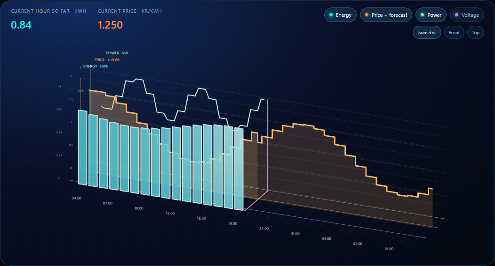

# Gleam Cards

Interactive glass/neon Home Assistant dashboard cards by
Magnus Øverli (<magnus@overli.dev>).

| Card | Status | Lovelace type | Configuration |
| --- | --- | --- | --- |
| Gleam Energy Graph | Stable | `custom:gleam-energy-graph` | YAML and visual editor |
| Gleam Thermostat | Experimental | `custom:gleam-thermostat` | YAML and visual editor |

Gleam Cards is one Home Assistant Marketplace dashboard package. Both cards
share a release version; the thermostat's Experimental badge describes its
limited real-device testing, not a separate update channel.

For a Marketplace release, run `npm ci`, test and build, then attach
`dist/gleam-card.js` to the GitHub Release as `gleam-card.js`. The root
`hacs.json` identifies that asset. Use a regular release for the stable package;
mark a release as a pre-release only to offer a beta of the **whole package**.




## Home Assistant Marketplace

[](https://my.home-assistant.io/redirect/marketplace_repository/?owner=magnusoverli&repository=gleam-card&category=plugin)

Use the button above to install the [published package](https://github.com/magnusoverli/gleam-card/releases).
Before catalog inclusion, this link offers to add the custom Dashboard repository.
After installation, reload the dashboard and select a card in **Add card**.
If migrating from the local installation below, remove its old resource registration.

Both cards and Three.js are bundled into one local JavaScript module. No CDN,
backend integration, or separate vendor directory is required.

## Build and preview

Use the latest stable Node.js and npm (currently Node 26.13.1 and npm 12.2.3).
The lockfile pins dependencies for reproducible installs.

```sh
npm ci
npm run build
npm run dev
```

Open the local URL printed by Vite. The preview uses synthetic data and mock
climate actions; it does not connect to Home Assistant. Source changes reload
the page automatically. Browser regression tests exercise the production bundle.

## Install locally

### Development deployment (no manual version increments)

Mount or share your Home Assistant configuration directory, then run:

```sh
npm run deploy -- --config "<path to Home Assistant config>"
```

Register `/local/gleam-card/loader.js` once as a **JavaScript module** in
**Settings → Dashboards → Resources**. Replace the previous Gleam resource
registration rather than adding a duplicate.

After each deployment, reload the dashboard. The stable loader fetches a fresh
manifest and imports the content-hashed bundle. No `?v=` changes or Home
Assistant restart are needed. The command writes only `www/gleam-card/`;
it does not edit Home Assistant settings or require an API token.

Older hashed bundles are retained for open clients. They can be removed when
no longer needed; keep the file named in `manifest.json`. Deployment requires
filesystem access; it does not automatically upload to a remote server.

### Manual single-file installation

Copy `dist/gleam-card.js` to `<Home Assistant config>/www/gleam-card.js`.
In **Settings → Dashboards → Resources**, register:

- URL: `/local/gleam-card.js?v=1`
- Type: **JavaScript module**

Reload the browser. Advanced Mode may be needed to see Resources.
Increment the existing resource URL's version when updating; avoid duplicate
registrations. No Home Assistant restart is needed.

Both cards appear in the card picker. Replace the example entity IDs with your
own entities. The thermostat controls operate the configured real device.

For the graph, open your dashboard → **Edit dashboard → Add card**, search for
**Gleam Energy Graph**, then choose your sensors and time window in the visual
editor and **Save**. Existing graph cards also support **Edit → Show visual editor**.

```yaml
type: custom:gleam-energy-graph
energy_entity: sensor.total_energy
current_hour_entity: sensor.current_hour_energy
price_entity: sensor.electricity_price
power_entity: sensor.power
voltage_entity: sensor.voltage
hours_to_show: 33
future_hours: 16.8
refresh_interval: 10
grid_options:
  columns: full
  rows: auto
```

```yaml
type: custom:gleam-thermostat
entity: climate.heat_pump
name: Heat pump
```

## Documentation

- [Energy graph configuration and data contract](docs/energy-graph.md)
- [Thermostat configuration and controls](docs/thermostat.md)
- [Development and verification](docs/development.md)
- [Release and catalog submission](docs/publishing.md)

WebGL 2 is required for 3D rendering. The thermostat retains its enabled HTML
controls if graphics initialization fails. The energy chart reports the error;
it does not yet provide an accessible table or HTML chart fallback.

## License

Original Gleam Card code uses the [Unlicense](LICENSE). Three.js retains its MIT
license, reproduced in [THIRD_PARTY_NOTICES.md](THIRD_PARTY_NOTICES.md) and embedded
in the built bundle. Development tools retain their respective licenses.
